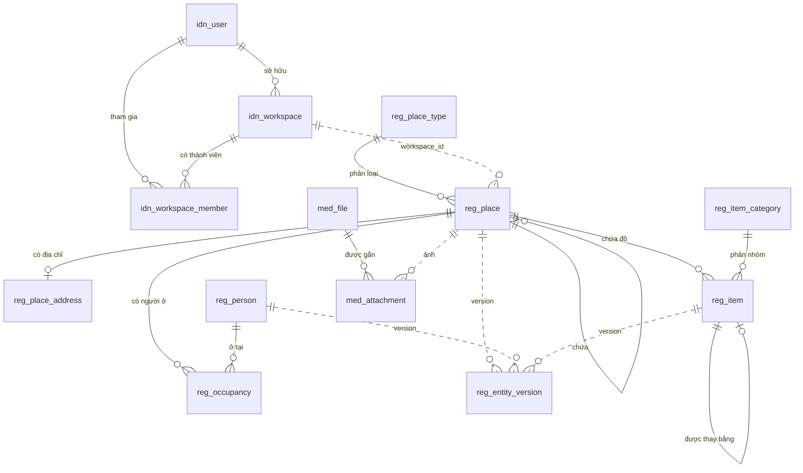

# Thiết kế database cho home-platform

Ngày: 2026-11-11 · Trạng thái: **đã duyệt, đã áp dụng ngày 2026-11-12** (mỗi service tự chạy migration của mình trên database `home_platform`).

Ký hiệu trong tài liệu: **(bạn)** là điều bạn đã nói; **(tôi chọn)** là quyết định của tôi, bạn có thể bác.

## 1. Hệ thống này là gì

Một kho hồ sơ về các địa điểm, luôn được cập nhật. Mỗi người dùng có một không gian riêng. Trong đó họ ghi lại các địa điểm của mình, kèm mô tả, hình ảnh, địa chỉ, người sống ở đó và đồ đạc bên trong. Mỗi lần sửa đều để lại một version xem lại và khôi phục được.

"Home" chỉ là tên gọi chung: một địa điểm có thể là khách sạn, chung cư, nhà ở, hoặc bất kỳ loại hạ tầng nào khác.

## 2. Mục tiêu, phần không làm, điều phải tránh

**Mục tiêu**

- Dữ liệu của mỗi không gian tách biệt hoàn toàn với không gian khác. **(bạn)**
- Chứa được mọi loại địa điểm, không giới hạn ở ba loại ví dụ. **(bạn)**
- Giữ lại quá khứ: ai từng ở, món đồ nào từng có, và version của mỗi lần sửa kèm người sửa, thời điểm sửa. **(bạn)**
- Chịu được tải lớn. **(bạn)** Tôi hiểu cụ thể là: vẫn đọc nhanh khi các bảng lên tới hàng trăm triệu dòng trên một máy chủ MySQL, và khi vượt mức đó thì chia ra nhiều máy chủ được mà không phải thiết kế lại. **(tôi chọn)**
- Hợp với cấu trúc microservice. **(bạn)**

**Không làm ở giai đoạn này**

- Mọi thứ liên quan tới tiền: hợp đồng, đặt phòng, hoá đơn. **(bạn)**
- Đăng nhập và phân quyền: tích hợp sau. **(bạn)** Thiết kế chỉ có bảng người dùng tối thiểu để biết ai sở hữu không gian nào và ai đã sửa gì.
- Tìm kiếm theo từ khoá bất kỳ trong nội dung. Database chỉ lo tìm theo tên bắt đầu bằng, theo mã, theo khu vực. **(tôi chọn)**

**Điều phải tránh**

- Một truy vấn đọc được dữ liệu của không gian khác.
- Mất lịch sử khi sửa hoặc xoá.
- Dữ liệu lịch sử làm chậm các bảng đang dùng hằng ngày.

## 3. Ràng buộc

- MySQL 8.0.36, database `home_platform` (hiện đang trống).
- Spring Boot 4.1, Java 21.

## 4. Các quyết định chính

### 4.1 Mọi không gian dùng chung bảng, phân biệt bằng `workspace_id` **(tôi chọn)**

Mỗi người một không gian nghĩa là số không gian có thể rất lớn. Tạo một database riêng cho từng người không khả thi ở quy mô đó: mỗi lần đổi cấu trúc phải chạy trên từng database, và MySQL chậm dần khi số bảng lên tới hàng trăm nghìn.

Vì vậy mọi bảng nghiệp vụ có cột `workspace_id`, và cột này **đứng đầu khoá chính**: khoá chính là `(workspace_id, id)`. Cách này có ba tác dụng:

- MySQL lưu các dòng theo thứ tự khoá chính, nên dữ liệu của một không gian nằm liền nhau trên đĩa và đọc nhanh.
- Không thể lấy một dòng chỉ bằng `id`; truy vấn nào cũng phải kèm `workspace_id`, nên khó đọc nhầm sang không gian khác.
- `workspace_id` là khoá sẵn có để sau này chia dữ liệu ra nhiều máy chủ.

### 4.2 `id` do ứng dụng sinh, tăng theo thời gian **(tôi chọn)**

`id` là số `BIGINT` do ứng dụng sinh (kiểu TSID/Snowflake: phần đầu là thời gian), không dùng `AUTO_INCREMENT`. Nhiều service và nhiều máy chủ sinh id cùng lúc mà không trùng, không phải hỏi database, và id mới luôn lớn hơn id cũ nên ghi vào cuối vùng dữ liệu của mỗi không gian.

Lưu ý cho phía web: số này vượt quá độ chính xác của kiểu số trong JavaScript, nên API phải trả `id` dưới dạng chuỗi.

### 4.3 Ba nhóm bảng theo ba service, chung một database **(tôi chọn)**

| Nhóm | Tiền tố | Nội dung |
|---|---|---|
| identity | `idn_` | Người dùng, không gian, thành viên |
| registry | `reg_` | Địa điểm, địa chỉ, người, việc cư trú, đồ đạc, version |
| media | `med_` | Thông tin file ảnh và việc gắn ảnh vào bản ghi |

- Trong cùng một nhóm có khoá ngoại, và khoá ngoại luôn kèm `workspace_id` nên không thể trỏ sang không gian khác.
- Giữa các nhóm **không có khoá ngoại và không join**; chỉ lưu `id` của nhau. Nhờ vậy sau này chuyển từng nhóm sang database hoặc máy chủ riêng mà không phải sửa cấu trúc.
- Địa điểm, người và đồ đạc nằm chung nhóm registry vì chúng luôn được đọc cùng nhau ("phòng này có ai, có gì"). Tách mỗi thứ một service sẽ biến mỗi lần đọc thành nhiều lần gọi qua mạng.

### 4.4 Địa điểm lồng trong địa điểm **(tôi chọn; đã nêu với bạn, bạn chưa phản đối)**

Một địa điểm có thể chứa địa điểm khác, tối đa 20 cấp: toà nhà chứa tầng, tầng chứa phòng. Người và đồ đạc gắn được vào bất kỳ cấp nào.

Mỗi địa điểm lưu hai thứ: `parent_id` (địa điểm cha) và `path` (chuỗi id từ gốc tới chính nó, ví dụ `/12/345/6789/`). Nhờ `path`, lấy toàn bộ cây con của một toà nhà là một lần quét index theo tiền tố, không phải dò từng cấp. Cái giá: khi chuyển một địa điểm sang cha khác phải cập nhật `path` của mọi địa điểm con. Việc này hiếm, còn đọc cây thì xảy ra liên tục.

### 4.5 Loại địa điểm và các mục thông tin do người dùng tự định nghĩa **(tôi chọn; đã nêu với bạn, bạn chưa phản đối)**

- Mỗi không gian có danh sách loại địa điểm riêng (`reg_place_type`). Khách sạn, chung cư, nhà ở, tầng, phòng chỉ là các loại tạo sẵn.
- Mỗi loại có các mục thông tin riêng, khai báo trong `reg_field_def` (ví dụ khách sạn có "số sao", căn hộ có "diện tích").
- Giá trị của các mục đó lưu trong cột `attributes` kiểu JSON trên chính dòng địa điểm. Người và đồ đạc cũng có cột này.

### 4.6 Lịch sử gồm hai lớp

**Lớp 1, quá khứ là dữ liệu thật.** **(tôi chọn)**

- Một người chuyển đi: dòng cư trú (`reg_occupancy`) được ghi ngày kết thúc, không bị xoá. Hỏi "ai từng ở phòng này" là một truy vấn bình thường.
- Một món đồ bị thay: món cũ được ghi ngày gỡ và trỏ tới món thay thế, không bị xoá.
- Một ảnh bị gỡ: dòng gắn ảnh được ghi người gỡ và thời điểm gỡ.

**Lớp 2, version của mỗi lần sửa.** **(bạn)**

- Các bảng chính chỉ giữ trạng thái hiện tại, kèm cột `version` tăng dần sau mỗi lần sửa.
- Mỗi lần tạo, sửa, xoá hay khôi phục một địa điểm, một người hoặc một món đồ, hệ thống ghi thêm một dòng vào `reg_entity_version`: toàn bộ nội dung bản ghi sau lần sửa đó (JSON), ai sửa, lúc nào. Việc ghi này nằm trong cùng một transaction với lần sửa, nên không thể có lần sửa nào thiếu version.
- Version của một địa điểm bao gồm cả địa chỉ của nó.
- Khôi phục là tạo một version mới mang nội dung của version cũ; không version nào bị ghi đè hay xoá. **(tôi chọn)**
- Cột `version` cũng dùng để chặn hai người sửa đè lên nhau: lệnh sửa chỉ thành công nếu `version` chưa đổi kể từ lúc đọc.

Tách như vậy để bảng chính luôn nhỏ và nhanh, còn bảng version chỉ ghi thêm và phình dần ở một chỗ riêng.

### 4.7 Xoá là xoá mềm **(tôi chọn)**

Địa điểm, người và đồ đạc không bị xoá khỏi bảng; chúng được đánh dấu bằng `deleted_at` và khôi phục được. Một địa điểm chỉ xoá được khi không còn địa điểm con, người đang ở hay đồ đạc đang đặt trong nó.

### 4.8 File ảnh nằm ngoài database **(tôi chọn)**

Database chỉ lưu thông tin về file (đường dẫn trong kho lưu trữ, kích thước, loại). Bản thân file nằm ở kho lưu trữ đối tượng (S3, MinIO hoặc tương đương).

## 5. Sơ đồ

Nét liền là khoá ngoại thật. Nét đứt là tham chiếu bằng `id`, không có khoá ngoại.

## 6. Chi tiết các bảng

### Quy ước chung

- Engine InnoDB, bảng mã `utf8mb4`, collation mặc định của server (`utf8mb4_0900_ai_ci`).
- Thời gian lưu kiểu `DATETIME(3)`, giờ UTC.
- Mã trạng thái là `VARCHAR` ngắn, không dùng `ENUM` (thêm giá trị mới không phải đổi cấu trúc bảng).
- "Cột chung" trong các bảng dưới đây gồm: `created_at`, `created_by`, `updated_at`, `updated_by`, `version` (INT, bắt đầu từ 1), `deleted_at` (NULL nếu chưa xoá). `created_by` và `updated_by` là `id` người dùng bên identity.

### Nhóm identity

**`idn_user`**: người dùng. Khoá chính `id`.

| Cột | Kiểu | Ý nghĩa |
|---|---|---|
| `id` | BIGINT | |
| `email` | VARCHAR(255) | Duy nhất |
| `display_name` | VARCHAR(150) | |
| `status` | VARCHAR(20) | ACTIVE, DISABLED |
| `created_at`, `updated_at` | DATETIME(3) | |

Các cột phục vụ đăng nhập sẽ thêm khi tích hợp security.

**`idn_workspace`**: không gian riêng của một người. Khoá chính `id`. Index: `(owner_user_id)`.

| Cột | Kiểu | Ý nghĩa |
|---|---|---|
| `id` | BIGINT | Chính là `workspace_id` ở mọi bảng khác |
| `owner_user_id` | BIGINT | Khoá ngoại tới `idn_user` |
| `name` | VARCHAR(150) | |
| `status` | VARCHAR(20) | ACTIVE, SUSPENDED |
| `created_at`, `updated_at` | DATETIME(3) | |

**`idn_workspace_member`**: ai được vào không gian nào. Khoá chính `(workspace_id, user_id)`. Index: `(user_id, workspace_id)`.

| Cột | Kiểu | Ý nghĩa |
|---|---|---|
| `workspace_id`, `user_id` | BIGINT | |
| `role` | VARCHAR(20) | OWNER, EDITOR, VIEWER |
| `joined_at` | DATETIME(3) | |

Lúc đầu mỗi không gian chỉ có một dòng là chủ của nó. Bảng này có sẵn để sau này mời thêm người mà không phải đổi cấu trúc. **(tôi chọn)**

### Nhóm registry

**`reg_place_type`**: loại địa điểm. Khoá chính `(workspace_id, id)`. Duy nhất: `(workspace_id, code)`.

| Cột | Kiểu | Ý nghĩa |
|---|---|---|
| `code` | VARCHAR(50) | Ví dụ HOTEL, APARTMENT, ROOM |
| `name` | VARCHAR(100) | Tên hiển thị |
| `description` | VARCHAR(500) NULL | |
| `sort_order` | INT | Thứ tự hiển thị |
| `status` | VARCHAR(20) | ACTIVE, ARCHIVED |
| `created_at`, `updated_at` | DATETIME(3) | |

**`reg_field_def`**: khai báo mục thông tin tuỳ biến. Khoá chính `(workspace_id, id)`. Duy nhất: `(workspace_id, target, type_id, field_key)`.

| Cột | Kiểu | Ý nghĩa |
|---|---|---|
| `target` | VARCHAR(10) | PLACE, PERSON hoặc ITEM |
| `type_id` | BIGINT | `id` loại địa điểm hoặc nhóm đồ; 0 nghĩa là áp dụng cho tất cả |
| `field_key` | VARCHAR(50) | Tên khoá trong cột `attributes` |
| `label` | VARCHAR(100) | Tên hiển thị |
| `data_type` | VARCHAR(20) | TEXT, NUMBER, BOOLEAN, DATE, SELECT |
| `options` | JSON NULL | Danh sách lựa chọn, dùng cho SELECT |
| `is_required` | TINYINT(1) | |
| `sort_order` | INT | |
| `status` | VARCHAR(20) | ACTIVE, ARCHIVED |
| `created_at`, `updated_at` | DATETIME(3) | |

**`reg_place`**: địa điểm. Khoá chính `(workspace_id, id)`.

| Cột | Kiểu | Ý nghĩa |
|---|---|---|
| `parent_id` | BIGINT NULL | Địa điểm cha; NULL là cấp cao nhất |
| `place_type_id` | BIGINT | Loại địa điểm |
| `path` | VARCHAR(512), ASCII | Chuỗi id từ gốc tới chính nó, ví dụ `/12/345/6789/` |
| `depth` | TINYINT | 0 là cấp cao nhất |
| `code` | VARCHAR(50) NULL | Mã do người dùng đặt, ví dụ P101 |
| `name` | VARCHAR(255) | |
| `description` | TEXT NULL | |
| `status` | VARCHAR(20) | ACTIVE, INACTIVE |
| `attributes` | JSON NULL | Giá trị các mục tuỳ biến |
| `cover_file_id` | BIGINT NULL | Ảnh đại diện; `id` bên media |
| Cột chung | | |

- Khoá ngoại: `(workspace_id, parent_id)` tới chính bảng này; `(workspace_id, place_type_id)` tới `reg_place_type`.
- Index: `(workspace_id, parent_id, name)`, `(workspace_id, path)`, `(workspace_id, place_type_id, name)`, `(workspace_id, name)`, `(workspace_id, code)`.

**`reg_place_address`**: địa chỉ, tối đa một cho mỗi địa điểm. Khoá chính `(workspace_id, place_id)`, đồng thời là khoá ngoại tới `reg_place`.

| Cột | Kiểu | Ý nghĩa |
|---|---|---|
| `country_code` | CHAR(2) | Mặc định VN |
| `province_code`, `province_name` | VARCHAR(10) NULL, VARCHAR(100) NULL | Tỉnh, thành phố |
| `district_code`, `district_name` | VARCHAR(10) NULL, VARCHAR(100) NULL | Quận, huyện |
| `ward_code`, `ward_name` | VARCHAR(10) NULL, VARCHAR(100) NULL | Phường, xã |
| `street` | VARCHAR(255) NULL | Số nhà, tên đường |
| `full_address` | VARCHAR(500) | Chuỗi địa chỉ đầy đủ để hiển thị |
| `latitude`, `longitude` | DECIMAL(9,6) NULL | Toạ độ |
| `geohash` | VARCHAR(12) NULL, ASCII | Mã ô lưới tính từ toạ độ |
| `created_at`, `updated_at` | DATETIME(3) | |

- Index: `(workspace_id, province_code, ward_code)`, `(workspace_id, geohash)`.
- Địa chỉ tách khỏi `reg_place` vì phần lớn địa điểm con (tầng, phòng) không có địa chỉ riêng; chúng dùng địa chỉ của địa điểm cha gần nhất có địa chỉ.
- Hai điểm gần nhau có `geohash` chung phần đầu, nên tìm quanh một toạ độ trong một không gian là quét index theo tiền tố.

**`reg_person`**: hồ sơ một người. Khoá chính `(workspace_id, id)`. Người ở đây là hồ sơ do chủ không gian ghi lại, không phải tài khoản đăng nhập.

| Cột | Kiểu | Ý nghĩa |
|---|---|---|
| `full_name` | VARCHAR(150) | |
| `phone` | VARCHAR(20) NULL | |
| `email` | VARCHAR(255) NULL | |
| `id_type`, `id_number` | VARCHAR(20) NULL, VARCHAR(30) NULL | Loại và số giấy tờ |
| `date_of_birth` | DATE NULL | |
| `gender` | VARCHAR(10) NULL | |
| `note` | TEXT NULL | |
| `attributes` | JSON NULL | |
| `avatar_file_id` | BIGINT NULL | `id` bên media |
| Cột chung | | |

Index: `(workspace_id, full_name)`, `(workspace_id, phone)`, `(workspace_id, id_number)`.

**`reg_occupancy`**: ai ở địa điểm nào, từ khi nào tới khi nào. Khoá chính `(workspace_id, id)`.

| Cột | Kiểu | Ý nghĩa |
|---|---|---|
| `place_id` | BIGINT | Khoá ngoại tới `reg_place` |
| `person_id` | BIGINT | Khoá ngoại tới `reg_person` |
| `relation` | VARCHAR(20) | OWNER, RESIDENT, GUEST, STAFF, OTHER |
| `start_date` | DATE | |
| `end_date` | DATE NULL | NULL nghĩa là đang ở |
| `note` | VARCHAR(500) NULL | |
| Cột chung | | |

- Index: `(workspace_id, place_id, end_date, start_date)`, `(workspace_id, person_id, start_date)`.
- Một người có thể có nhiều dòng: ở nhiều nơi cùng lúc, hoặc lần lượt qua nhiều nơi.

**`reg_item_category`**: nhóm đồ đạc. Khoá chính `(workspace_id, id)`. Duy nhất: `(workspace_id, name)`.

| Cột | Kiểu | Ý nghĩa |
|---|---|---|
| `name` | VARCHAR(100) | Ví dụ Nội thất, Điện tử |
| `sort_order` | INT | |
| `status` | VARCHAR(20) | ACTIVE, ARCHIVED |
| `created_at`, `updated_at` | DATETIME(3) | |

**`reg_item`**: đồ đạc. Khoá chính `(workspace_id, id)`.

| Cột | Kiểu | Ý nghĩa |
|---|---|---|
| `place_id` | BIGINT | Đang đặt ở đâu; khoá ngoại tới `reg_place` |
| `category_id` | BIGINT NULL | Khoá ngoại tới `reg_item_category` |
| `code` | VARCHAR(50) NULL | Mã hoặc số sê-ri |
| `name` | VARCHAR(255) | |
| `quantity` | INT | Mặc định 1 |
| `unit` | VARCHAR(20) NULL | Cái, bộ, ... |
| `status` | VARCHAR(20) | IN_USE, BROKEN, STORED, REMOVED |
| `placed_at` | DATE NULL | Ngày đưa vào |
| `removed_at` | DATE NULL | Ngày gỡ ra; NULL nghĩa là còn ở đó |
| `replaced_by_item_id` | BIGINT NULL | Món thay thế nó |
| `description` | TEXT NULL | |
| `attributes` | JSON NULL | |
| `cover_file_id` | BIGINT NULL | `id` bên media |
| Cột chung | | |

- Index: `(workspace_id, place_id, removed_at, name)`, `(workspace_id, category_id, name)`, `(workspace_id, name)`, `(workspace_id, code)`.
- Món đồ chỉ lưu vị trí hiện tại. Việc nó từng nằm ở phòng nào trước đó xem được qua các version của nó. **(tôi chọn)**

**`reg_entity_version`**: version của địa điểm, người, đồ đạc. Khoá chính `(workspace_id, entity_type, entity_id, version_no)`.

| Cột | Kiểu | Ý nghĩa |
|---|---|---|
| `entity_type` | VARCHAR(20) | PLACE, PERSON, ITEM |
| `entity_id` | BIGINT | |
| `version_no` | INT | Trùng với `version` của bản ghi tại thời điểm đó |
| `action` | VARCHAR(10) | CREATE, UPDATE, DELETE, RESTORE |
| `snapshot` | JSON | Toàn bộ nội dung bản ghi sau lần sửa |
| `changed_fields` | JSON NULL | Tên các cột đã đổi |
| `changed_by` | BIGINT | `id` người dùng |
| `changed_at` | DATETIME(3) | |
| `note` | VARCHAR(255) NULL | Ghi chú của người sửa |

- Index: `(workspace_id, changed_at)`.
- Không có khoá ngoại, để version sống lâu hơn bản ghi gốc.
- Chia sẵn thành 64 phần theo `workspace_id` (`PARTITION BY KEY`). Đây là bảng lớn nhất hệ thống và chỉ ghi thêm; chia từ đầu thì rẻ, còn chia một bảng đã lớn thì phải dựng lại cả bảng. **(tôi chọn)**

### Nhóm media

**`med_file`**: thông tin một file đã tải lên. Khoá chính `(workspace_id, id)`. Index: `(workspace_id, checksum_sha256)`.

| Cột | Kiểu | Ý nghĩa |
|---|---|---|
| `storage_key` | VARCHAR(500) | Đường dẫn trong kho lưu trữ |
| `original_name` | VARCHAR(255) | |
| `content_type` | VARCHAR(100) | |
| `size_bytes` | BIGINT | |
| `width`, `height` | INT NULL | Kích thước ảnh |
| `checksum_sha256` | CHAR(64), ASCII | Để nhận ra file trùng |
| `status` | VARCHAR(20) | PENDING, READY, DELETED |
| `uploaded_by` | BIGINT | |
| `created_at` | DATETIME(3) | |

**`med_attachment`**: gắn một file vào một bản ghi. Khoá chính `(workspace_id, id)`.

| Cột | Kiểu | Ý nghĩa |
|---|---|---|
| `owner_type` | VARCHAR(20) | PLACE, PERSON, ITEM |
| `owner_id` | BIGINT | `id` bên registry |
| `file_id` | BIGINT | Khoá ngoại tới `med_file` |
| `caption` | VARCHAR(255) NULL | |
| `sort_order` | INT | |
| `added_by`, `added_at` | BIGINT, DATETIME(3) | |
| `removed_by`, `removed_at` | BIGINT NULL, DATETIME(3) NULL | NULL nghĩa là ảnh còn hiển thị |

Index: `(workspace_id, owner_type, owner_id, removed_at, sort_order)`.

## 7. Các truy vấn chính và index phục vụ

Mọi truy vấn đều bắt đầu bằng `workspace_id`.

| Câu hỏi | Bảng và index |
|---|---|
| Các địa điểm cấp cao nhất, hoặc con trực tiếp của một địa điểm, xếp theo tên | `reg_place (workspace_id, parent_id, name)` |
| Toàn bộ cây con của một địa điểm | `reg_place (workspace_id, path)`, quét theo tiền tố |
| Các địa điểm thuộc một loại | `reg_place (workspace_id, place_type_id, name)` |
| Tìm địa điểm theo tên bắt đầu bằng, hoặc theo mã | `reg_place (workspace_id, name)`, `(workspace_id, code)` |
| Các địa điểm trong một tỉnh, một phường | `reg_place_address (workspace_id, province_code, ward_code)` |
| Các địa điểm quanh một toạ độ | `reg_place_address (workspace_id, geohash)` |
| Ai đang ở một địa điểm; ai từng ở đó | `reg_occupancy (workspace_id, place_id, end_date, start_date)` |
| Một người đã ở những đâu | `reg_occupancy (workspace_id, person_id, start_date)` |
| Tìm người theo tên, số điện thoại, số giấy tờ | Ba index của `reg_person` |
| Đồ đạc đang có ở một địa điểm; đồ đã gỡ | `reg_item (workspace_id, place_id, removed_at, name)` |
| Các version của một bản ghi | Khoá chính của `reg_entity_version` |
| Hoạt động gần đây trong không gian | `reg_entity_version (workspace_id, changed_at)` |
| Ảnh của một bản ghi | Index của `med_attachment` |

Danh sách dài được phân trang theo vị trí (lấy tiếp sau giá trị cuối của trang trước), không dùng `OFFSET`, để trang thứ một nghìn vẫn nhanh như trang đầu.

## 8. Vì sao thiết kế này chịu được tải lớn

- **Dữ liệu của một không gian nằm liền nhau**, nên truy vấn chỉ đọc một vùng nhỏ của bảng dù bảng có hàng trăm triệu dòng.
- **Bảng đang dùng hằng ngày chỉ chứa trạng thái hiện tại.** Version và file, hai thứ lớn nhất, nằm ở chỗ riêng.
- **Mỗi truy vấn thường gặp có đúng một index phục vụ** (mục 7), không truy vấn nào phải quét cả bảng.
- **Đọc cây con là một lần quét index**, không đệ quy.
- **`id` không phụ thuộc database**, nên thêm máy chủ không tạo ra điểm nghẽn sinh id.
- **Không có khoá ngoại hay join giữa các nhóm**, nên mỗi nhóm chuyển được sang máy chủ riêng.

## 9. Đường mở rộng khi tải tăng

Chưa làm ngay; thiết kế hiện tại không cản trở bước nào.

1. Thêm máy chủ chỉ đọc (replica) để chia tải đọc.
2. Đưa dữ liệu ít đổi (loại địa điểm, khai báo mục tuỳ biến) vào bộ nhớ đệm.
3. Chuyển tìm kiếm theo từ khoá sang một công cụ tìm kiếm riêng.
4. Tách từng nhóm bảng sang database hoặc máy chủ riêng.
5. Chia dữ liệu ra nhiều máy chủ theo `workspace_id`.
6. Nếu cần lọc theo mục tuỳ biến trên dữ liệu lớn: thêm một bảng chỉ mục riêng cho các mục được đánh dấu là lọc được.

## 10. Sau bước xây dựng

**Đã quyết định khi tạo bảng**

- Thay đổi cấu trúc database do Flyway quản lý. Script nằm ở `src/main/resources/db/migration` của từng service, và mỗi service có bảng lịch sử riêng (`flyway_history_identity`, `flyway_history_registry`, `flyway_history_media`).
- `geohash` là cột thường, do ứng dụng tính từ toạ độ.
- Tên index và khoá ngoại: xem `docs/superpowers/plans/2026-11-11-database-schema.md`.

**Còn để lại cho các tính năng đầu tiên dùng tới bảng**

- Thư viện sinh `id`.
- Danh sách loại địa điểm và nhóm đồ tạo sẵn cho mỗi không gian mới.
- Cách ứng dụng bảo đảm mọi truy vấn đều kèm `workspace_id`.
